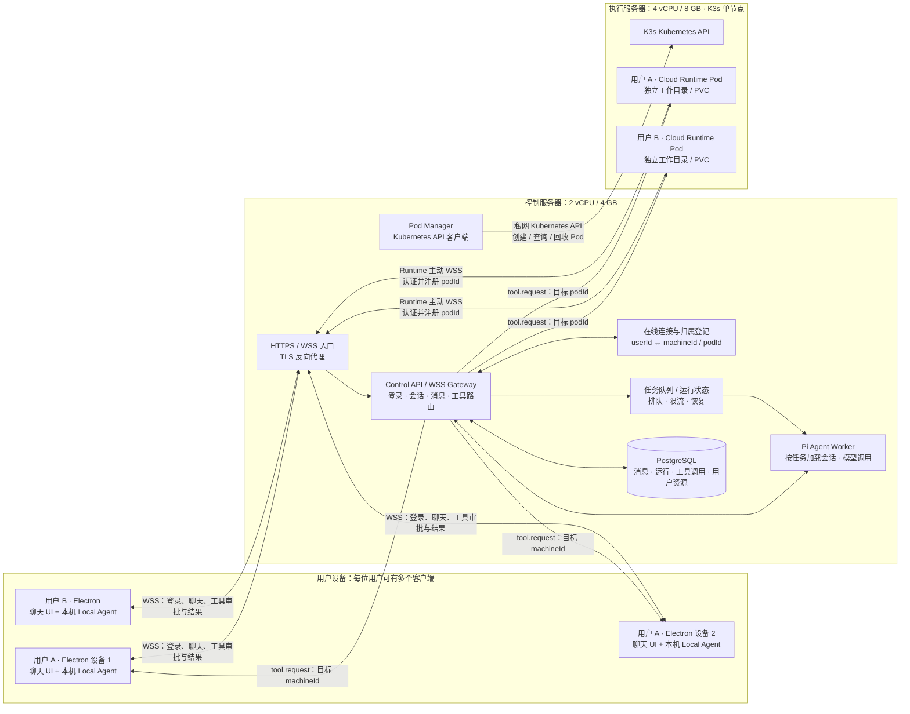

# TwinBot 本地 + 云端 Agent：完整架构与实施方案

本文档是当前仓库的目标架构和落地路线。初期部署目标为两台云服务器：

- **控制服务器：2 vCPU / 4 GB RAM**，运行初期 Control API、Pi Agent 引擎和数据库；这是小规模 MVP 配置，不承诺承载 1000 个活跃连接或任务。
- **执行服务器：4 vCPU / 8 GB RAM**，运行 K3s，并为最多两个初期用户运行独立的 Cloud Runtime Pod。
- **每位用户：一个或多个 Electron 客户端**，连接同一个 Control API；每个用户可以使用云端 Pod，也可以授权在指定 Electron 设备上执行本机工具。

这是一套适合小规模 MVP 的单控制节点架构，不等同于高可用集群。Agent 调用外部模型 API，不在 2C4G 服务器本机运行大模型。面向 1000 个同时在线用户时，控制面需拆分为可横向扩展的连接网关和 Agent Worker，并进行容量压测。

## 1. 架构概览



### 核心原则

1. 多个 Electron 客户端连接同一套服务端；控制服务器上的 Agent 引擎为所有用户提供编排能力，但每次运行都必须带有并校验已认证的 `userId` 与 `sessionId`。
2. **Agent 引擎负责思考和调度，不直接访问用户文件或在控制服务器执行用户命令。** Pi 提供的默认本地文件/命令工具不能直接暴露给多租户 Agent；只向 Agent 提供经过授权的自定义工具。
3. 每个工具调用必须有明确执行目标：某个已登录的 Electron `machineId`，或者该用户自己的云端 `podId`。
4. K3s API 用于 Pod 生命周期管理；工具指令通过 Runtime 主动连接控制器的 WSS 通道传送。不要为每个 Pod 暴露公网执行端口。
5. 服务端从认证凭证和资源绑定关系推导用户归属，不能信任请求体传来的 `userId` 来授权路由。
6. 第一阶段按“一个用户一个 Cloud Runtime Pod”实现。4C8G 机器初期最多规划两个用户 Pod；以后增加执行节点和 Pod 数量，不需要改变桌面端协议的基本方向。

## 2. 组件职责

| 组件 | 部署位置 | 职责 |
|---|---|---|
| Electron Renderer | 用户设备 | 登录、聊天、显示 Agent 状态、选择本机/云端执行、展示本机工具审批 |
| Electron Main / Local Agent | 用户设备 | 使用设备凭证连接 WSS，报告 `machineId` 和能力；在用户设备执行获准的本机工具并返回结果 |
| Control API / WSS Gateway | 初期在 2C4G 控制服务器；规模增长后多实例部署 | 身份认证、会话 API、WebSocket 接入、连接登记、工具路由、请求超时与结果关联；不在连接处理器中同步执行长时间 Agent 任务 |
| Pi Agent Worker | 初期与 Control API 同机；规模增长后横向扩展 | 从持久化存储加载本轮所需会话上下文，调用模型、规划步骤、调用受控工具；任务结束后释放运行内存，不删除会话数据 |
| PostgreSQL | 初期可与 Control API 同机；生产扩展后独立部署/扩容 | **持久化完整会话消息、Agent 运行、工具调用/结果、用户与资源元数据**；作为恢复依据，不存明文模型密钥 |
| 任务队列 | 初期可使用 PostgreSQL-backed queue；规模增长后按实测选择独立队列 | 缓冲 Agent 任务、限制并发、追踪重试/超时；任务状态需持久化，避免进程重启丢失 |
| Pod Manager | Control API 的内部模块 | 使用受限 Kubernetes ServiceAccount，创建、查询、停止和回收用户 Pod；不执行用户任务 |
| Cloud Runtime | 每个用户的 K3s Pod | 主动连接 Control API，验证收到的工具请求，在 Pod 隔离边界内执行云端工具并回传结果 |
| K3s | 4C8G 执行服务器 | 调度 Runtime Pod、限制资源、管理 PVC 和网络策略 |
| TLS 入口代理 | 控制服务器 | 对外提供 HTTPS/WSS，终止 TLS，转发到 Control API；只开放必要公网端口 |

## 3. 工具执行与路由

### 请求流程

1. 用户登录 Electron，Control API 验证凭证并签发短期访问凭证和可轮换的设备凭证。
2. Electron 通过 WSS 连接控制服务器。服务端根据凭证登记 `userId`、`machineId`、在线状态和能力；设备上报的 `machineId` 只作为标识，不能代替身份认证。
3. 用户发送聊天消息。Control API 验证会话归属，将消息交给 Agent Engine，并在本次运行上下文中固定经过验证的 `userId`、`sessionId`。
4. Agent Engine 决定调用某个工具，并给出执行目标（例如用户指定的本机设备或云端工作目录）。
5. 服务端验证该工具、目标、会话和资源绑定关系，然后创建有唯一 `requestId` 和截止时间的工具请求。
6. 如果目标是本机，Control API 通过对应 Electron 的 WSS 发送 `tool.request`。如果目标是云端，Control API 通过该用户 Runtime 已建立的 WSS 发送请求。
7. 执行端在必要时请求用户批准，然后执行工具，并以相同的 `requestId` 回传 `tool.result`。批准与执行结果是两个独立事件；服务端需分别校验并关联。
8. Control API 将结果交回原 Agent 运行；Agent 可继续调用工具，或生成最终回复，再通过用户的会话连接推送给 Electron。

### 控制器如何找到并通知 Pod

Cloud Runtime Pod 启动时，使用 Pod 专属身份凭证主动向 Control API 建立 TLS WSS 连接。认证成功后，服务端从凭证/Pod 元数据确认其 `userId` 与 `podId` 并登记在线连接。工具调用到来时，服务端按已认证的用户和数据库中的 Pod 绑定关系选择连接，再发送 `tool.request`。Pod 执行完成后在同一连接上返回 `tool.result`。Pod 断线时，连接登记变为离线；请求按超时策略失败或等待 Runtime 重连，不应误投递给其他用户。

Pod Manager 与 Runtime 执行通道是两套独立机制：

- **生命周期管理：** Control API → 私有 Kubernetes API → K3s 创建/停止/查询 Pod。
- **工具执行：** Runtime Pod → 主动 WSS → Control API；控制器通过此已认证连接下发任务。

### 本机/云端选择

- 本机文件、桌面环境等能力只能路由到用户明确绑定且在线的 `machineId`。
- 云端文件和命令只能路由到该用户绑定的 `podId`。
- UI 应显示当前执行位置，并允许用户明确切换本机或云端；不应在本机离线时静默把本机任务改投云端。
- 某个目标离线时，返回明确的 `MACHINE_OFFLINE` 或 `TIMEOUT`，提示用户选其他设备/目标或重试。
- 设备重连后重新认证和登记；旧连接应被替换或按设备策略受控并发，不能仅凭 `machineId` 接管他人会话。

## 4. 协议与接口需要补齐的部分

当前 `packages/ws-protocol` 只有基础 hello、工具请求/结果、审批和心跳类型。落地服务端与 Runtime 前，需要明确并运行时校验消息 schema，至少覆盖：

- 认证后的连接角色：Electron Device 或 Cloud Runtime；角色与用户归属由服务端凭证确定。
- 连接注册/注销、能力列表、心跳和在线状态。
- 聊天消息、Agent 增量事件和最终响应。
- 工具请求、审批请求/回应、工具结果、取消与超时。
- `requestId`、`sessionId`、目标资源 ID、协议版本，以及可选的幂等标识。
- Runtime Pod 专属凭证的签发、轮换和撤销。

协议约束：

- 对所有入站 JSON 使用 Zod 等运行时 schema 校验；类型断言不是验证。
- 每个工具请求设置服务端截止时间；重复结果、未知请求 ID、过期请求应被拒绝并记录。
- 长时间执行的任务应支持取消；断线后不自动重复执行有副作用的工具，除非工具具有幂等保护。
- `requiresApproval` 应由服务端策略决定，执行端不能自行降低审批要求。
- 认证凭证不能放在会被日志记录的 URL query 中；使用 TLS，并通过安全请求头或受控的一次性连接票据认证。日志不得输出凭证或密钥。
- 限制消息大小、并发任务数和单次工具执行时间；连接需要心跳、重连退避和过期请求清理。

## 5. 数据、模型与租户隔离

### 必须持久化的数据（从第一阶段开始）

- `users`：账户状态、认证提供方标识。
- `sessions`：`owner_user_id`、标题、创建/更新时间、归档状态等。
- `messages`：**每条用户消息和 Agent 回复**，包含 `session_id`、`owner_user_id`、角色、内容、顺序号和时间；消息写入数据库是接受用户消息的前置条件。
- `agent_runs`：每轮运行的状态（queued/running/completed/failed/cancelled）、模型/上下文引用、开始/结束时间、错误摘要和恢复信息。
- `tool_calls`：工具请求、目标资源、审批状态、执行状态、结果或错误、超时和幂等键。敏感工具输出按数据策略过滤或加密。
- `run_events`：需要向 UI 流式展示且支持断线续传的事件，使用单调递增游标/序号；数据库是事实来源，在线推送只是通知。
- `machines`：`owner_user_id`、`machine_id`、设备名称、能力、最后在线时间和撤销状态。
- `runtimes`：`owner_user_id`、`pod_id`、Kubernetes namespace、运行状态、最后在线时间。
- `user_model_settings`：默认模型、供应商和额度策略。
- `tool_audit_events`：发起人、会话、目标、工具、审批决定、结果码和时间；避免记录敏感文件内容或凭证。

会话消息和 Agent 进程生命周期必须分离：Agent Worker 可以在一轮完成后释放内存，但下次继续会话时，必须依据 `owner_user_id` 从数据库读取会话消息/摘要和未完成运行状态。用户重连时，服务端按最后接收的事件游标从 `run_events` 补发缺失事件。摘要和模型上下文裁剪用于减少推理成本，不得删除或替代原始持久化消息。数据库应配置备份与恢复演练；Pod/PVC 的文件持久化不能代替聊天数据库。

### 一轮对话的持久化顺序

1. 在数据库事务中创建用户消息和 `agent_run(status='queued')`，成功提交后才确认接受请求。
2. 可靠地将运行任务放入队列；使用事务 outbox 或同等机制，避免“数据库已写但任务没入队”。
3. Worker 领取任务后将状态更新为 `running`，按用户和会话归属加载历史，处理模型调用及工具路由。
4. 每个工具调用、审批、结果和 Agent 最终消息均持久化；流式事件以游标写入，推送失败可从数据库补发。
5. Worker 崩溃后由队列重试/恢复任务；通过运行状态、工具调用幂等键和执行端 requestId 避免重复副作用。不可安全重试的工具调用需标记为待确认/失败，不能盲目重放。

### 多租户约束

- 每条会话、设备、Pod、模型配置查询都必须以服务端认证的 `userId` 做归属过滤。
- Pi Agent 每次运行创建隔离的用户上下文和工具集合；不得将一个用户的消息历史、密钥或执行目标复用给另一个用户。
- 模型 API Key 应加密后存储，密钥加密密钥通过服务器秘密配置管理，不提交仓库；日志和桌面端不暴露服务端平台密钥。
- Kubernetes namespace / label / Pod 绑定关系由服务端维护；不能允许用户传入任意 `podId` 后直接执行。
- 用户 Pod 不挂载宿主机敏感目录、不使用 privileged 模式、不挂载控制服务器凭证。

## 6. 初期服务器部署方案

### 控制服务器：2C4G

运行：

1. TLS 反向代理（例如 Caddy 或 Nginx）。
2. `control-api` Node.js 服务，内含 WSS Gateway、Pi Agent Engine 和 Pod Manager 模块。
3. PostgreSQL；从第一阶段开始存储完整会话消息、运行和工具调用状态。
4. 第一阶段队列可与 PostgreSQL 同机部署/共享数据库；应限制并发，不表示该单机可以承载 1000 个活跃任务。

模型推理通过配置的外部模型 API 完成。2C4G 是小规模起步配置；应监控 Node 内存、PostgreSQL、并发会话和模型请求延迟。如需本机运行大模型或高并发 Agent，应重新评估资源。

### 执行服务器：4C8G

运行单节点 K3s；初期在该节点调度两个独立 Runtime Pod。推荐从保守资源限制起步，再通过实际负载测试调整，例如每 Pod request `500m CPU / 1Gi RAM`、limit `1500m CPU / 2Gi RAM`。给操作系统和 K3s 留出资源；PVC 大小根据实际磁盘空间和用户文件预算配置。资源请求/限制不是容量保证，启动浏览器、构建或高并发命令会显著增加消耗。

每个 Runtime Pod 至少应：

- 使用非 root 用户、删除不必要 Linux capabilities、启用 seccomp，禁止 privileged。
- 将用户工作目录挂载到该用户独立 PVC；容器重建后按产品策略保留数据。
- 设置 CPU、内存、临时存储和并发任务限制。
- 使用 Pod 专属、可轮换且仅能连接控制面的身份凭证。
- 通过 NetworkPolicy 限制入站；按工具实际需求限制出站。确认 K3s 网络策略控制器在当前安装配置中确实启用并生效。
- 镜像固定版本/摘要，不在 Pod 内安装未受控的 Docker daemon。

### 两台机器之间的管理网络

- Control API 到 K3s Kubernetes API 的连接走 WireGuard/Tailscale 等私网，或通过严格源 IP 限制的管理网；不要把 `6443` 无限制暴露到公网。
- Pod Runtime 到控制服务器走 TLS WSS；只需开放控制服务器的 HTTPS/WSS 公网入口。
- 创建最小权限的 Kubernetes ServiceAccount/RBAC，仅允许在指定 namespace 内管理 Runtime Pod、PVC 和所需对象；避免直接使用全权限 `cluster-admin` kubeconfig。
- 数据库只监听本机/私网，不公开公网端口。
- 配置系统更新、备份、磁盘监控、日志轮转、TLS 证书续期和恢复演练。

## 7. 1000 个活跃用户的控制面扩展方案

先区分三个容量指标：

- **在线连接数**：用户 Electron 与控制面的 WebSocket 长连接数。1000 个在线连接不等于 1000 个正在调用模型的 Agent 任务。
- **并发 Agent 运行数**：此刻正在等待模型、执行工具或生成回复的任务数。它决定模型供应商限额、Worker 并发和任务队列压力。
- **云端 Pod 数/并发执行数**：若承诺每个用户独立常驻 Pod，1000 个用户就意味着约 1000 个 Runtime 工作负载及其持久卷；4C8G 执行机显然不够，需要多节点 K3s 集群、容量/成本规划，或经产品确认后采用按需启动/休眠策略。

### 目标服务形态

```text
1000+ Electron WSS 连接
          │
          ▼
负载均衡器 / TLS
          │
          ├── WSS Gateway 实例 × N ── 共享在线连接目录 / 事件通知
          │                                │
          │                                └── Redis 等低延迟 presence/pub-sub（按需）
          └── HTTP API 实例 × N
                         │
                         ├── PostgreSQL：消息、会话、运行和工具状态的事实来源
                         └── 持久任务队列 → Agent Worker × N → 外部模型 API
                                                    ├── 本机工具：路由到指定 Electron 连接
                                                    └── 云端工具：路由到用户 Runtime 连接
```

- Gateway 只负责认证、连接、限流、协议校验和收发事件；Agent 模型调用不能占住 Gateway 的请求处理流程。
- Worker 是可横向扩展的任务消费者，不为 1000 个用户各常驻一个 Agent 进程。每轮任务从数据库加载持久化历史/摘要，完成后释放临时内存。
- WebSocket 连接可分布在多个 Gateway 实例上。连接目录记录 `userId/deviceId -> gatewayInstanceId`；跨实例消息通过共享事件通道转发。浏览器/客户端重连后用 `sessionId + lastEventCursor` 从数据库补取遗漏事件，不依赖某个 Gateway 的内存。
- 队列控制 Worker 并发和背压；按账户、模型供应商和全局设置并发/速率限制。队列满或供应商限流时明确排队/拒绝并展示状态，不无限堆积任务。
- PostgreSQL 持续保存完整对话与运行记录。连接和 Agent 运行实例可以迁移/重启，用户历史不能因实例释放而丢失。
- 初期可用 PostgreSQL-backed durable queue 降低运维组件数量；当数据库队列负载或吞吐经压测确认成为瓶颈，再引入独立消息队列。Redis 可用于在线 presence 和快速通知，但不作为会话历史的唯一存储。

### 1000 用户容量结论与上线门槛

- **不能承诺单台 2C4G 控制服务器承载 1000 个活跃用户。**单机配置仅是前述 MVP；1000 个低频在线连接与 1000 个同时运行的 Agent 任务是完全不同的负载，实际能力取决于连接心跳频率、消息速率、上下文长度、模型 API 配额、工具任务时长、数据库 I/O 和各实例资源。
- 1000 个同时在线连接应以多 Gateway 实例进行负载测试；Worker 数量依据目标并发任务和模型供应商限制单独扩容。将“1000 在线”当作连接容量目标，不应直接配置为“1000 并发 Agent”。
- 生产化前须测量目标环境的连接数、每秒消息数、Agent 同时运行数、队列等待时间、模型速率限制、数据库写入/读取延迟、断线恢复时间和资源峰值；设置容量余量和过载保护。
- 至少进行 1000 个模拟 WSS 连接测试和逐步增加 Agent 并发的负载测试。验收门槛应由产品明确的 SLA（例如 p95 首 token/完成时间、错误率、恢复时间）决定；没有 SLA 和压测结果时，不给出单机/集群的确定承载数字。
- 1000 个用户若都要求一个常驻 Pod/PVC，执行集群须按每个 Runtime 的实际 CPU、内存、存储、空闲占用和峰值测算节点数。不要把“4C8G 两个 Pod”的 MVP 描述误读为可扩展到 1000 用户。

## 8. 仓库落地结构建议

延续当前 npm workspaces 与 TypeScript，不在此阶段引入微服务集群、消息队列或 Redis。服务端初期可作为一个部署单元，模块内部保持边界：

```text
apps/
  desktop/                 # 已有：Electron UI 与本机 Local Agent
  control-api/             # 新增：HTTP/WSS、认证、会话、路由、Pi、Pod Manager
  cloud-runtime/           # 已有基础客户端：Pod 身份登记与心跳；工具执行待实现
packages/
  tool-protocol/           # 已有：工具名、参数、结果 schema
  ws-protocol/             # 已有：扩展并运行时校验 WSS 消息
deploy/
  control/                 # 控制服务部署配置、反向代理示例、环境变量模板
  k3s/                     # Namespace、RBAC、Runtime Deployment/PVC/NetworkPolicy
```

持久化 schema / migration 和测试应放在 `apps/control-api` 的常规源码与测试目录中，按该应用选定的数据库工具组织；不要将密钥或生产 kubeconfig 放进 `deploy/`。

## 9. 分阶段实施与验收

### 阶段 0：固定协议和执行契约

**当前进度：基础消息运行时校验、Authorization header 认证及准确的 fs capability 已实现；本机 fs.read 的请求关联、审批和结果往返已实现；Agent run 取消 API、持久状态和 Pi AbortSignal 传播已实现，Worker 通过轮询持久状态支持由其他共享数据库的 Control API 实例发起取消；工具级取消协议与运行时限流仍待实现。**

- 定义连接身份、用户/设备/Pod 归属、请求 ID、截止时间、审批、取消、错误和重连语义。
- 为现有 WS 消息增加运行时 schema，并在 Electron 主进程和服务端复用。
- 移除把连接 token 拼进 URL 和打印完整 URL 的做法；确认令牌不会进入日志。
- 修正 capability 通告，使其只声明 Local Agent 实际已实现的能力。

**验收：** 非法/缺字段消息被拒绝；未认证连接不能注册或下发工具；token 不出现在 URL、日志和错误文本中。

### 阶段 1：本地单机控制面闭环

**当前进度：开发态会话/消息 API、认证 WSS 接入、机器登记、PostgreSQL 初始 schema/repository、持久 outbox Worker 和 Pi Coding Agent SDK v1.4.0 已搭建。Worker 从数据库恢复会话历史并持久化回复/失败状态；同一会话已有 queued/running 任务时 API 返回 409。Electron 已有持久会话列表、聊天和运行状态轮询 UI；Control API 凭证留在主进程，IPC 限定于本地应用主 frame，远程导航和弹窗被拒绝。Pi 只开放自定义 `local_fs_read` / `local_fs_list` 工具，默认文件/shell 工具关闭；本机请求需 Electron 用户批准并按请求 ID 回传结果。`tool_calls` 持久化请求、审批决策、目标设备及结束状态，不存工具参数/文件路径/返回内容；单实例启动时会将遗留请求标记为 `SERVICE_RESTARTED`，但不会重放操作。实际 PostgreSQL 集成仍未验证。Pi SDK 要求 Node.js >=22.19.0。**

- 新增 `apps/control-api`：健康检查、用户认证、Electron WSS 接入和连接注册；用户可取消自己的 queued/running run，Worker 通过轮询共享数据库观察跨实例取消并中止 Pi 会话，取消与完成竞争时不写入迟到回复。
- 开发/测试环境可使用本地 PostgreSQL；建立用户、会话、消息、Agent 运行、工具调用和设备归属的数据模型。消息持久化不可推迟到后续阶段。
- 用户消息和运行任务在确认接收前持久化；运行状态、最终回复/失败状态及本机 `fs.read` / `fs.list` 的脱敏审计状态均已持久化。服务重启时遗留工具请求标记为 `failed/SERVICE_RESTARTED`，不会自动重放。断线后按事件游标恢复仍待实现。
- **已实现本机 `fs.read` / `fs.list` 路由与 request/response 超时关联：** Control API 仅向已认证用户明确选择的在线 `fs` 设备，或唯一在线的合格设备发送请求；Electron 审批后回传与原请求 ID 关联的结果。未选择且多台设备在线时安全拒绝并提示需要选择目标；已选择设备离线时不会自动回退到其他设备。
- 仅接受已认证且属于当前用户的在线 machine；不接 K3s，不启用任意命令执行。

**验收：** `fs.read` 的 Pi → Control API → 已认证 Electron → 审批 → 结果 → Pi 往返由本地模型桩和 WebSocket 集成测试覆盖；`fs.list` 的协议、Agent 工具注册、控制面路由和目录枚举也有测试。用户隔离、错误连接、离线、多设备歧义、设备选择和超时均有测试。尚缺真实模型和 PostgreSQL 集成验证。

### 阶段 2：Pi Agent Engine 接入

- **Pi Agent 已接入：** Control API 使用与官方 Pi v1.4.0 Release 同版本的 `@earendil-works/pi-coding-agent` SDK；通过 `AGENT_PROVIDER`、`AGENT_MODEL` 和 API 凭证配置模型，并从持久化历史恢复对话上下文。默认禁用 Pi 的本机文件、shell、扩展和 skills，仅注册经 Control API 路由、由 Electron 用户审批的自定义 `local_fs_read` / `local_fs_list`。
- 后续补齐按用户隔离模型配置、Agent 中间事件和流式事件续传。
- 只注册 `local.*` / `cloud.*` 等受控自定义工具；工具内部调用统一路由接口。
- 按用户隔离模型设置和密钥；实现 Agent 中间事件、最终回复和错误回传到 Electron。
- 明确审批策略：本机工具由 Electron 用户确认；高风险云端工具由客户端确认或服务端策略拒绝，不能绕过。

**验收：** 已验证本地 OpenAI-compatible 模型桩可恢复持久历史、请求自定义本机工具并生成最终文本；本机 WSS 审批与结果关联也有集成测试。尚未验证真实模型、多用户隔离及真实 PostgreSQL；引擎不能直接调用控制服务器本地文件或 shell。

### 阶段 3：Cloud Runtime 与工具执行闭环

**当前进度：已完整实现并验证。**

- **沙箱安全与文件边界：** `apps/cloud-runtime` 实现了独立的工作区检查逻辑（`runtimeFileTools.ts`），严格限制操作仅在 `CLOUD_RUNTIME_WORKSPACE`（或默认当前工作区）内，自动防范路径穿越越界（Path Traversal）以及指向工作区外部的非法符号链接（Symlink Escape），并规范化了 POSIX 路径返回。
- **工具长连接下发与执行：** Runtime 启动并通过凭证鉴权后，主动向 Control API 发送 `runtime.hello` 注册 Pod 身份与 `capabilities: ['fs']`；支持监听并处理服务端的 `tool.request`（支持 `fs.read`、`fs.list`），完成文件读取和目录枚举后在同一 WSS 长连接上回传带原 `requestId` 的 `tool.result`。
- **控制面路由与沙箱审计：** Control API 的 `LocalToolRouter` 支持维护已注册的云端 Runtime，并提供 `requestCloudFsRead` 和 `requestCloudFsList`。云端工具执行属于沙箱受控环境，默认 `requiresApproval: false`（无需向 Electron 弹窗审批），但生命周期（`requested -> approved -> completed/failed`）同样原子化记录入 PostgreSQL `tool_calls` 脱敏审计表，确保审计链路完整。
- **Pi Agent 引擎能力注册：** Control API 的 Pi Agent SDK 注册了 `cloud_fs_read` 和 `cloud_fs_list` 工具，使 Agent 在分析调度时可直接操作云端沙箱文件。
- **单机与分布式演进支持：** 引入 `SERVER_ROLE` 配置（`all` | `gateway` | `worker`），使系统在单台 2C4G 节点上可全功能一体化运行，同时为未来走向多服务器架构提供平滑无缝的解耦基础。
- **生产容器化与部署配置落地：** 在 `deploy/` 下落地了 Control API 与 Cloud Runtime 的生产 Dockerfile、针对 2C4G 控制服务器的 `docker-compose.yaml` 及 Nginx 反向代理配置、以及针对 4C8G 执行机的 K3s 清单（命名空间、网络策略、PVC、两个独立用户 Pod 配额限制）和 Docker Compose 备选方案。

**验收结论：**

1. 控制器只能把用户 A 的请求路由到用户 A 认证绑定的 Runtime Pod；当 Runtime 离线时返回标准的 `RUNTIME_OFFLINE`，绝不跨租户串线；
2. Cloud Runtime 收到恶意越界路径时能安全拒绝并返回 `NOT_FOUND` 或 `PERMISSION_DENIED`；
3. 全工程 93 项自动化集成与单元测试全量 PASS，端到端工具闭环验证通过。

### 阶段 4：Pod 生命周期自动化与第二个用户

- 配置控制服务器到执行服务器的私有管理网络和受限 Kubernetes RBAC。
- Pod Manager 以幂等方式按 `userId` 创建/查询/停止 Pod、PVC，并记录绑定关系。
- 增加双用户隔离测试、配额、Pod 离线恢复与用户删除/数据保留策略。
- 将两用户 Pod 部署到 4C8G 执行机，压测并按数据调整 requests/limits。

**验收：** 两个用户各有独立 Pod、PVC 和 Runtime 凭证；用户不能列举、连接或操作另一用户 Pod；重复开通不会创建重复资源。

### 阶段 5：生产化桌面端和运维

- 完善 Electron 正式登录、设备管理、云端/本机执行位置选择、实时在线状态和流式审批 UI；本机文件工具目标选择、持久会话列表、基础聊天输入及运行结果轮询已实现。
- 完成本机 capability 展示、在线设备状态列表和本机文件工具目标选择；在线设备列表反映当前 Control API 实例内存连接，选择偏好持久化到 PostgreSQL 并在设备重新连接时恢复。跨实例在线连接目录仍待实现。云端能力声明、版本兼容提示、取消任务和请求超时仍待实现；Electron WSS 已实现指数退避和随机抖动。
- 配置正式域名/TLS、备份/恢复、日志轮转、监控告警、镜像更新与安全补丁流程。
- 进行凭证撤销、用户隔离、恶意/超时工具请求、服务器重启和备份恢复演练。

**验收：** Electron 可在多台设备登录同一账户；用户可以明确选择本机或云端执行；服务或机器重启后能恢复连接与持久数据，且不会重复执行不具幂等性的任务。run 取消 UI/API 和共享数据库下的跨实例 Worker 中止已具备；完整登录、多实例在线连接目录和云端执行选择仍待完成。

## 10. 需要在正式实现前确认的产品策略

以下内容不会阻止 MVP 架构成立，但上线前需定下来：

- 用户登录方式及账号邀请/注册规则。
- 每个用户最多绑定多少台 Electron 设备；工具调用时如何选择目标设备。
- 用户 Pod/PVC 删除、账户注销、闲置 Pod 休眠和数据保留期限。
- 云端 `shell.exec` 是否开放、哪些命令需要审批、出网访问范围和任务额度。
- 是否允许用户自带模型 API Key，以及密钥加密、轮换和额度结算规则。
- 两台服务器之间使用 WireGuard、Tailscale 还是云厂商私网。

## 11. 当前仓库与目标之间的差距

已有：

- `packages/tool-protocol`：工具和结果类型/Zod schema，涵盖 `fs.read`、`fs.list` 与云端/本地错误码标准。
- `packages/ws-protocol`：WebSocket 消息类型和运行时 Zod schema，支持客户端与云端 Runtime 身份绑定与能力注册。
- `apps/desktop`：Electron 会话/聊天 UI、受限 IPC、`machineId`、WSS 重连、本机批准流程、`fs.read` / `fs.list`，以及在线设备 capability 列表 UI。
- `apps/cloud-runtime`：独立云端沙箱运行时，支持工作区安全路径限制与防越界；支持向 Control API 建立 WSS 反向长连接，完成 `runtime.hello` 注册、心跳保活、受控执行 `fs.read` / `fs.list` 并回传结果。
- `apps/control-api`：开发态 token 认证及静态生产 bearer-token 映射、HTTP 会话/消息 API、在线设备与云端 Pod 路由管理、PostgreSQL repository/schema；支持根据已认证身份路由本机与云端工具；支持 `SERVER_ROLE`（all/gateway/worker）分层。
- `messages`、`agent_runs`、`task_outbox` 的原子写入逻辑：新用户消息、queued run 和 outbox 事件在同一个事务中提交；Worker 通过持久 outbox 领取任务、读取历史并保存模型回复或失败状态。`tool_calls` 保存工具请求、审批和结束状态以及租户、run、session 关联，不保存敏感文件参数或内容。Pi Coding Agent SDK v1.4.0 已接入，开放受控的 `local_fs_*` 与 `cloud_fs_*` 工具。
- 生产部署配置集（`deploy/`）：提供 Control API 与 Cloud Runtime 的 Dockerfile、控制服务器 2C4G 的 `docker-compose.yaml` 与 Nginx TLS 反代配置，以及执行机 4C8G 的 K3s 网络策略、PVC 与双用户 Pod 编排清单（附带纯 Docker Compose 备选方案）。
- Electron 跨平台安装包支持（Windows NSIS、macOS DMG、Linux AppImage 配置）。

尚未实现：

- 版本化数据库迁移工具（如 Flyway/Prisma/Drizzle/golang-migrate），生产级多因素认证与自助凭证管理系统。
- 跨多 Control API 实例的分布式在线连接目录（如基于 Redis 的 Pub/Sub 或分布式 Presence）与流式事件断点续传。
- 自动化 Pod 管理控制器（Pod Manager 调用 Kubernetes API 自动动态伸缩/创建 Pod；当前采用预置 Deployment/PVC 静态纳管）。
- 扩展的高级工具集：云端 `shell.exec` 沙箱执行与文件同步。
- 生产级代码签名证书与应用发布管线。

Electron 当前没有配置代码签名证书、macOS 公证或产品图标；即使安装包构建成功，正式分发前仍需完成签名与发布流程。

当前 `dev-token` 仅适用于本地开发。`NODE_ENV=production` 需配置 `CONTROL_TOKENS_JSON` 中至少 32 字符的 token 到 user ID 映射，且不会回退到开发凭证；密钥管理、签发/过期、撤销、正式登录、设备凭证管理和 HTTPS/WSS 部署运维流程仍需建设。该静态映射不是生产登录方案，也不代表当前单进程实现可承载 1000 个活跃连接。


## 12. 2026-10 能力补齐（已落地）

相对上一节「差距」清单，下列能力已在本仓库实现（不含 SaaS 账号连接器）：

1. **长期记忆**：Postgres `user_memories`；REST `/v1/memories`；Pi Agent 工具 `memory_list` / `memory_set` / `memory_delete`，并在系统提示中注入摘要。
2. **例程调度**：Postgres `routines`（`cron` / `interval` / `event`）；`RoutineScheduler` 轮询 due 任务并经 `appendUserMessage` 入队；REST `/v1/routines`；`session.created` 可触发 event 例程。
3. **流式 session.delta**：Worker / 接受消息路径经 WSS 推送 `run.status`、`message.created`、`routine.fired`；桌面 `ControlWsClient` → IPC `session:delta` → 渲染层；`waitForRun` 以 delta 为主、3s 轮询兜底。
4. **密钥与本地沙箱**：GET 模型配置只返回掩码；可选 `MODEL_SECRETS_KEY` AES-GCM 落库加密；提交掩码占位符时保留原密钥。桌面 `LOCAL_WORKSPACE_ROOT`（默认 userData/workspace）+ `LocalWorkspaceGuard`；`desktop.config.json` 已 gitignore，示例见 `desktop.config.example.json`，优先 userData。
5. **Runtime 选择**：`runtime_selections` + `POST /v1/runtimes/selection`；路由不再固定 `eligible[0]`；多 Pod 未选择时返回 `TARGET_SELECTION_REQUIRED`。桌面 Pod 面板可选活动 Runtime。
6. **真终端**：右侧终端经 `shell.exec` UI 通道在选中云端沙箱真实执行（已从假输出改为真实工具调用）。
